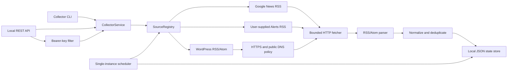

# Architecture Overview

The CLI and API share the same source registry, fetcher, parser, and normalizer. The local API exposes health and OpenAPI routes and protects `/v1/*` with a bearer key. Scheduled inputs are encrypted at rest, and the store applies configurable item retention.

WordPress requests use HTTPS and reject private or unsafe DNS resolutions before connection. Reddit support was canceled and its connector removed; historical stored items remain readable while old schedules are discarded. Issuu public discovery is not available through a documented official route; no scraping or hidden endpoint is used.
