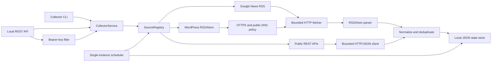

# Architecture Overview

The CLI and API share the same source registry and normalizer. RSS sources use the bounded HTTP fetcher and RSS/Atom parser; REST sources use the bounded HTTP/JSON client. The local API exposes health and OpenAPI routes and protects `/v1/*` with a bearer key. Scheduled inputs are encrypted at rest, and the store applies configurable item retention.

WordPress requests use HTTPS and reject private or unsafe DNS resolutions before connection. The REST client keeps provider hosts fixed, enforces request and response limits, and does not follow redirects. Google Alerts collection and scheduling are removed while historical items and runs remain available. Reddit support was canceled and its connector removed; historical posts remain readable. Issuu public discovery is not available through a documented official route; no scraping or hidden endpoint is used.
