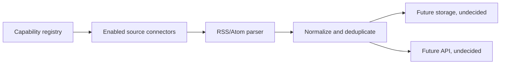

# Architecture Overview

**Status:** proposed only; no adapters or runtime are implemented.

The committed source of truth is [SPEC.md](../../SPEC.md). WordPress public RSS/Atom is the recommended first slice after approval. Google News is an undocumented candidate; Google Alerts depends on account feed availability; Reddit, Issuu, and Mercado Livre remain gated by documented permitted access.
